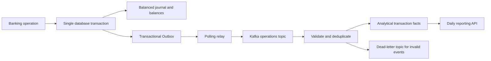

# LedgerFlow data pipeline

The first implemented data stage is event-driven streaming ingestion into a
PostgreSQL analytical read model. Code lives in the backend's
`com.ledgerflow.pipeline` module; the banking domain remains a modular monolith.

See [Pipeline contract and operations](../docs/data-pipeline.md) for the exact
patterns, event format, failure behavior, startup instructions and tests.

Spark/PySpark, Airflow and Power BI are subsequent stages; they are not required
or implemented in this first ingestion stage.
