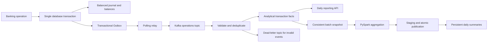

# LedgerFlow data pipeline

The first implemented data stage is event-driven streaming ingestion into a
PostgreSQL analytical read model. Code lives in the backend's
`com.ledgerflow.pipeline` module; the banking domain remains a modular monolith.

See [Pipeline contract and operations](../docs/data-pipeline.md) for the exact
patterns, event format, failure behavior, startup instructions and tests.

The second stage is now implemented in `ledgerflow_batch`: PySpark 4.1.0 reads a
consistent snapshot of the facts, validates and aggregates by date/currency/type,
and publishes daily summaries through staging and atomic range replacement.
See [Daily PySpark batch](../docs/batch-pyspark.md) and the
[complete French documentation](../docs/documentation-complete.md).

Optional Airflow orchestration, incident recovery, monitoring and Grafana dashboards
are documented in [Operations](../docs/operations.md). The native Power BI project
is documented in [Power BI](../docs/power-bi.md).
