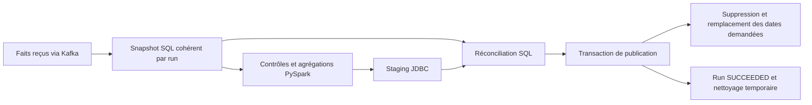

# Batch quotidien PySpark

## Fonctionnement et patterns

Le batch complète le streaming existant. Son entrée est
`analytics.transaction_facts` ; sa sortie est `analytics.daily_operation_summary`.
Il s'agit d'une **matérialisation batch par partitions de dates**, avec snapshot,
staging, réconciliation et remplacement transactionnel de la plage.

Le grain est `(event_date UTC, currency, operation_type)` et les mesures sont
`operation_count`, `total_amount`, `min_amount`, `max_amount`. OPENING est séparé
des dépôts ; un virement est une opération ; aucune conversion de devise n'est faite.
Les montants ne sont jamais convertis en flottants Python.



Un verrou consultatif PostgreSQL de session sérialise les batchs. Il n'empêche
pas l'API bancaire ni le consommateur d'ajouter des faits. Un batch concurrent
échoue avec un code de sortie non nul et peut être relancé.

## Démarrer et calculer

Depuis la racine :

```powershell
docker compose -f compose.yaml -f compose.pipeline.yaml -f compose.batch.yaml --profile app up --build -d
Invoke-RestMethod http://localhost:8080/actuator/health
```

Attendre UP : les tables V4 sont créées par Flyway dans le backend. Le batch ne
crée pas le schéma de production. Le profil `batch` n'est pas activé au démarrage.

```powershell
# Construire l'image et traiter hier UTC
docker compose -f compose.yaml -f compose.batch.yaml --profile batch run --rm --build daily-batch
# Une date explicite
docker compose -f compose.yaml -f compose.batch.yaml --profile batch run --rm daily-batch --date 2026-10-15
# Recalculer les dates potentiellement affectées par un retard
docker compose -f compose.yaml -f compose.batch.yaml --profile batch run --rm daily-batch --from 2026-10-01 --to 2026-10-15
```

`--date` et `--from/--to` s'excluent. Une plage doit être ordonnée, complète et ne
pas dépasser 366 jours inclusifs. Sans arguments, hier est déterminé en UTC.
Ce CLI reste manuel. Le DAG Airflow optionnel automatise son exécution quotidienne ;
voir [Exploitation](operations.md).

Exemple de sortie, avec un UUID différent à chaque tentative :

```json
{"run_id":"ac900afd-3249-4bb7-ac28-ac5edbb124a7","status":"SUCCEEDED","start":"2026-10-15","end":"2026-10-15","source_count":4,"group_count":4}
```

```powershell
Invoke-RestMethod 'http://localhost:8080/api/analytics/batch/daily?from=2026-10-15&to=2026-10-15'
Invoke-RestMethod 'http://localhost:8080/api/analytics/batch/runs?limit=10'
```

La première API retourne les mesures, `runId` et `computedAt`. La seconde permet
de consulter les états RUNNING/SUCCEEDED/FAILED, les dates de calcul, la taille
d'entrée, le nombre de groupes et le type d'erreur éventuel.

## Cohérence et relance

Le snapshot est copié par une instruction `INSERT ... SELECT` PostgreSQL. Il
reste stable pendant les actions Spark, même si de nouveaux événements arrivent.
Spark lit ce snapshot via JDBC et écrit ses agrégats dans le staging. Une vérification
SQL indépendante compare tous les groupes et toutes les mesures au snapshot.

La publication supprime puis réinsère uniquement les synthèses des dates demandées,
dans une seule transaction. Un lecteur voit un état publié cohérent. Aucune
écriture Spark `overwrite` n'est utilisée sur la table exposée.

- Relancer les mêmes faits : mêmes mesures, nouveau run ; aucun cumul des anciens totaux.
- Fait tardif : relancer sa date après ingestion ; il est intégré au nouveau snapshot.
- Journée vide : aucun groupe, et les anciens groupes de cette date sont supprimés.
- Autres dates : leurs résultats ne changent pas.
- Répétition de tâche JDBC : des lignes de staging strictement identiques sont dédupliquées.
- Lignes contradictoires, incomplètes ou invalides : échec de validation, publication précédente conservée.

Ce n'est pas un calcul incrémental par watermark, ni une promesse exactement une
fois pour les tâches Spark. La robustesse repose sur la séparation entre les
écritures temporaires et la publication contrôlée.

## Paramètres et exploitation

| Paramètre | Rôle |
| --- | --- |
| PGHOST, PGPORT | Serveur PostgreSQL, port 5432 par défaut |
| PGDATABASE, PGUSER | Base et utilisateur |
| PGPASSWORD | Mot de passe obligatoire, jamais placé dans l'URL JDBC |
| SPARK_MASTER | `local[2]` par défaut, environnement local validé |
| JDBC_DRIVER_JAR | Pilote PostgreSQL intégré à l'image |

L'image fixe Spark 4.1.0 et le pilote 42.7.13 avec checksum. Psycopg 3.3.3 pilote
les transactions de publication. Le calcul Spark s'exécute sous l'utilisateur
Spark de l'image, avec deux partitions de shuffle pour ce premier environnement.

Une exception gérée marque le run FAILED et nettoie ses snapshots/stagings. Une
panne brutale ou une perte de connexion peut laisser un run RUNNING et des
intermédiaires. Vérifier les processus et le verrou avant toute maintenance.
L'archivage des anciens runs et le traitement automatique des runs abandonnés
restent à implémenter.

Les synthèses reflètent les faits consommés au snapshot. Un `pending` nul ne
prouve pas que Kafka a tout projeté ; consulter aussi `published`, `processed`
et la DLT avant de déclarer une journée complète.

## Tests

L'image inclut pytest. Pour les tests sans PostgreSQL :

```powershell
docker build -t ledgerflow-batch-test data-pipeline
docker run --rm --entrypoint python3 ledgerflow-batch-test -m pytest -q -p no:cacheprovider
```

Les tests d'intégration sont activés par `BATCH_INTEGRATION=1` et exigent une base
jetable dont le nom se termine par `_batch_test`. Ils réinitialisent les tables
analytiques de cette base ; ne pas pointer sur des données à conserver.
Le répertoire des migrations est monté en lecture seule sous `/migrations`.
Le workflow GitHub contient la commande complète dans son job `batch`.

Les scénarios vérifient les décimaux, les regroupements, les dates invalides,
la qualité des faits, le JDBC Spark/PostgreSQL, l'idempotence, les données tardives,
la journée vide, les échecs de réconciliation et le verrou concurrent.
