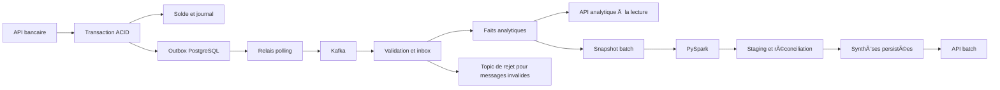

# LedgerFlow — documentation technique et fonctionnelle complète

État de référence : 15 octobre 2026. LedgerFlow est une plateforme pédagogique
qui simule un backend bancaire fiable et transforme ses opérations en données
analytiques. Cette documentation décrit le code présent, ses garanties et ses
limites ; elle ne présente pas les éléments de la feuille de route comme acquis.

## 1. Technologies, techniques et choix de conception

### 1.1 Technologies effectivement utilisées

| Technologie | Version ou configuration | Rôle dans le projet |
| --- | --- | --- |
| Java | 21 | Logique métier bancaire et ingestion événementielle |
| Spring Boot | 4.1.1 | Application web, injection, configuration et intégrations |
| Maven | Wrapper 3.9.16 | Dépendances, compilation, tests et JAR exécutable |
| Spring Web MVC / Tomcat | Versions gérées par Spring Boot | API REST JSON |
| Spring Data JPA / Hibernate | Versions gérées par Spring Boot | Persistance des comptes, virements et journaux |
| Bean Validation | Jakarta Validation | Validation des requêtes HTTP |
| Spring JDBC | Version gérée par Spring Boot | Outbox, projection analytique et lectures SQL |
| PostgreSQL | 18 | Données transactionnelles, faits analytiques et résultats batch |
| Flyway | Version gérée par Spring Boot | Migrations SQL V1 à V4 |
| Apache Kafka | Broker 4.1.2, KRaft | Transport durable des événements d'opération |
| Spring for Apache Kafka | Version gérée par Spring Boot | Producteur, consommateur, acquittement et rejet des messages |
| Jackson | Bibliothèques gérées par Spring Boot | Contrat JSON des événements et API |
| Python | Python 3 de l'image Spark | Orchestration du traitement batch |
| Apache Spark / PySpark | 4.1.0, Java 21, `local[2]` par défaut | Calcul des agrégats par DataFrames |
| Pilote JDBC PostgreSQL | 42.7.13 dans l'image batch, checksum SHA-256 fixé | Lecture et écriture Spark/PostgreSQL |
| Psycopg | 3.3.3 | Transactions de préparation, contrôle et publication du batch |
| Py4J | 0.10.9.9 | Communication Python/JVM pour PySpark |
| JUnit / Spring Boot Test / MockMvc | Versions gérées par Spring Boot | Tests métier, de concurrence, de migration et d'API |
| H2 | Dépendance de test | Exécution rapide sans serveur PostgreSQL |
| pytest | 8.4.2 | Tests Python, Spark réel et intégration PostgreSQL |
| Docker et Docker Compose | Images et services déclarés dans le dépôt | Environnement reproductible de développement et de test |
| Git et GitHub Actions | Workflow `backend.yml` | Versionnement et vérification automatique backend/batch |
| Spring Boot Actuator | Endpoints `health` et `info` | État de santé de l'application |

Les versions gérées restent définies par le parent Maven. Le broker Kafka et
les clients Java ne doivent pas être confondus : leurs versions peuvent différer.
Le projet ne dépend pas de React, FastAPI, Talend, Kubernetes ou d'un service
cloud pour son fonctionnement actuel.

### 1.2 Techniques structurantes

- **Monolithe modulaire** : le domaine bancaire et l'ingestion Kafka restent
  dans une application Spring Boot. Le batch PySpark est un processus séparé.
- **Transactions ACID** : un mouvement financier, ses écritures et son événement
  Outbox sont validés ensemble ou annulés ensemble.
- **Verrouillage pessimiste** : les opérations concurrentes sérialisent l'accès
  aux comptes concernés. Les virements verrouillent les UUID dans un ordre fixe.
- **Idempotence** : une répétition de requête avec la même clé et les mêmes
  paramètres retourne le résultat initial sans refaire le mouvement.
- **Montants décimaux exacts** : `BigDecimal`, `NUMERIC` et `DecimalType` évitent
  les erreurs d'arrondi des nombres flottants binaires.
- **Séparation écriture/lecture, style CQRS** : les opérations bancaires écrivent
  leur modèle métier ; les analyses lisent des projections dédiées.
- **Ingestion streaming puis matérialisation batch** : Kafka alimente les faits,
  puis Spark recalcule les synthèses des dates demandées.
- **Snapshot → staging → publication atomique** : un batch incomplet ne remplace
  pas une synthèse valide, et une relance ne cumule pas ses anciens résultats.

Ce fonctionnement hybride ne constitue pas une architecture Lambda complète :
il n'existe pas deux chemins indépendants dont les résultats seraient fusionnés.
Le batch travaille sur les faits canoniques déjà ingérés par le streaming.

## 2. Objectif et périmètre fonctionnel

LedgerFlow permet de créer des comptes de simulation, d'effectuer des dépôts,
des retraits et des virements, de conserver un journal équilibré et d'exploiter
les opérations à des fins d'analyse. Le but est de démontrer la cohérence métier,
la gestion de la concurrence, la fiabilité des échanges et la reproductibilité
des calculs data.

Le périmètre actuel comprend :

1. Comptes, soldes et montants d'ouverture de simulation.
2. Dépôts et retraits avec contrôle de fonds et de capacité du solde.
3. Virements atomiques entre comptes de même devise.
4. Journal en partie double et historique paginé.
5. Capture transactionnelle des événements, publication Kafka et déduplication.
6. Faits analytiques, indicateurs calculés à la lecture et état du pipeline.
7. Batch PySpark quotidien, synthèses persistées et historique d'exécution.
8. Conteneurisation, migrations, tests automatisés et CI.

Il n'y a pas encore d'interface graphique, d'authentification, de rôles ou de
vérification de propriété des comptes. Un titulaire est un libellé texte, pas
une entité utilisateur authentifiée. Aucun argent réel ni connexion à une banque
n'est impliqué.

## 3. Organisation du dépôt

```text
ledgerflow-backend/
  src/main/java/com/ledgerflow/banking/   # comptes, virements, journal, API métier
  src/main/java/com/ledgerflow/pipeline/  # Outbox, Kafka, projection et API analytique
  src/main/resources/db/migration/        # V1, V2, V3, V4
  src/test/                              # tests Java et bases de test
  Dockerfile
  pom.xml
data-pipeline/
  ledgerflow_batch/                       # configuration, Spark, stockage, CLI
  tests/                                 # tests de transformations et d'intégration
  Dockerfile
  requirements.txt
docs/                                    # documentation de référence
infrastructure/                          # emplacement réservé, pas de déploiement cloud
compose.yaml                             # PostgreSQL et backend optionnel
compose.pipeline.yaml                    # ajout de Kafka et activation du streaming
compose.batch.yaml                       # traitement quotidien optionnel
.github/workflows/backend.yml            # tests backend et job PySpark
```

## 4. Logique bancaire et garanties

### 4.1 Création d'un compte

Un compte contient un UUID, un titulaire de 1 à 120 caractères non blancs, un
code devise de trois lettres majuscules et un solde. Le code n'est pas vérifié
contre un registre ISO ; aucun change de devise n'est proposé.

Le solde initial peut être nul ou positif. Un solde non nul produit un journal
`OPENING`. Une ouverture à zéro ne produit pas de mouvement financier. Ces fonds
sont fournis par le scénario de simulation ; ce ne sont pas des dépôts externes.

### 4.2 Dépôt et retrait

Un dépôt augmente le solde ; un retrait le diminue et est refusé si les fonds
sont insuffisants. Une opération requiert un montant strictement positif, au
plus 17 chiffres entiers et 2 décimales. Un solde ne peut dépasser
`99999999999999999.99` ni devenir négatif.

Le compte est verrouillé jusqu'à la fin de la transaction. Le nouveau solde,
le journal et l'Outbox sont enregistrés ensemble. Une panne d'écriture entraîne
le rollback, y compris si le journal avait déjà été envoyé à la base par un flush.
Un flush n'est pas un commit.

### 4.3 Virement

Le compte source et le compte destination doivent exister, être différents et
avoir la même devise. Le service verrouille leurs UUID dans un ordre stable,
vérifie les fonds et le plafond du destinataire, puis débite et crédite dans une
seule transaction. Un seul événement représente le virement, pas deux opérations
analytiques distinctes.

### 4.4 Clé d'idempotence

`Idempotency-Key` est obligatoire pour les dépôts, retraits et virements. Elle
contient 1 à 100 caractères parmi les lettres, chiffres et `._:-`.
Son espace est global aux opérations : une clé de dépôt ne peut pas servir à un
retrait ou à un virement différent.

- Même clé, même opération, mêmes comptes et même montant numérique : résultat initial.
- Même clé, paramètres différents : conflit HTTP 409.
- Deux demandes concurrentes : les verrous et contraintes uniques empêchent un double effet.

Les clés sont conservées avec les opérations. Les dates sont ramenées à la
précision microseconde pour garder un résultat stable après relecture en base.

### 4.5 Journal en partie double

Du point de vue de la banque, les fonds d'un client sont un passif : un crédit
client augmente son solde, un débit client le diminue.

| Mouvement | Débit | Crédit |
| --- | --- | --- |
| Ouverture non nulle | Trésorerie de simulation | Compte client |
| Dépôt | Trésorerie de simulation | Compte client |
| Retrait | Compte client | Trésorerie de simulation |
| Virement | Compte client source | Compte client destination |

Un enregistrement `journals` stocke les deux jambes avec un montant et une
devise communs. Les contraintes SQL rendent impossible une seule jambe ou un
montant différent entre les jambes de cet enregistrement. L'API restitue deux
entrées, `DEBIT` et `CREDIT`, sous `CUSTOMER:<uuid>` ou `CASH:<devise>`.

Il n'existe pas de table séparée pour chaque jambe ni de plan comptable complet.
Le journal est immuable dans l'application, sans API de modification/suppression ;
un administrateur de base reste techniquement capable d'éditer les données.

## 5. Modèle de données et migrations

| Table | Grain et rôle |
| --- | --- |
| `accounts` | Un compte et son solde courant |
| `transfers` | Un virement avec clé d'idempotence |
| `journals` | Une opération financière équilibrée |
| `outbox_events` | Un événement immuable de journal et son état de publication |
| `analytics.processed_events` | Un événement consommé et son hash canonique |
| `analytics.transaction_facts` | Un fait par événement validé |
| `analytics.batch_runs` | Une tentative de calcul sur une plage de dates |
| `analytics.batch_source_snapshot` | Une copie temporaire des faits retenus pour un run |
| `analytics.daily_summary_stage` | Des agrégats intermédiaires, avant publication |
| `analytics.daily_operation_summary` | Une synthèse par date UTC, devise et type d'opération |

Le modèle analytique partage actuellement PostgreSQL avec le modèle bancaire,
dans un schéma distinct. Ce n'est pas encore un entrepôt dimensionnel séparé.
Les faits n'ont pas de clé étrangère vers les comptes/journaux du modèle bancaire :
la projection consomme le contrat événementiel, pas les entités JPA.

| Migration | Contenu |
| --- | --- |
| V1 | Comptes, virements, contraintes et index |
| V2 | Journal équilibré et reconstitution des ouvertures/virements existants |
| V3 | Outbox, inbox consommateur, faits et capture des journaux historiques |
| V4 | Historique batch, snapshot, staging et synthèses quotidiennes |

Flyway applique les migrations dans l'ordre ; Hibernate valide le schéma.
Une migration appliquée ne doit pas être réécrite. Les anciennes ouvertures
reconstituées par V2 ont une date de migration, car V1 n'enregistrait pas leur date
originale. Cela limite l'interprétation historique des dates d'ouverture.

## 6. Pipeline streaming et contrat d'événement



### 6.1 Transactional Outbox et Polling Publisher

Le service bancaire capture l'événement dans sa transaction. Il ne publie pas
synchroniquement vers Kafka pendant le traitement HTTP. L'indisponibilité de
Kafka n'empêche donc pas le dépôt ou le virement d'être validé en PostgreSQL.

Le relais se déclenche par défaut toutes les secondes et traite au plus 25
événements par passage. Il sélectionne une ligne disponible avec
`FOR UPDATE SKIP LOCKED`, attend l'acquittement Kafka, puis la marque publiée.
Chaque ligne est traitée dans une transaction propre. Un échec conserve la ligne,
incrémente les tentatives et programme une reprise avec délai exponentiel borné.

Le producteur utilise l'idempotence Kafka et `acks=all`. La frontière PostgreSQL /
Kafka reste néanmoins **au moins une fois** : une panne après l'acquittement mais
avant le commit de publication peut provoquer une réémission.

### 6.2 Idempotent Consumer et Inbox

Le consommateur valide la version et la structure du JSON. Il normalise le montant,
calcule un hash SHA-256 du contrat et insère l'ID dans l'inbox avec le fait dans la
même transaction. Une répétition identique est ignorée ; un ID réutilisé avec un
contenu différent est rejeté. L'offset Kafka est acquitté après le commit de cette
projection (`RECORD`, auto-commit désactivé).

Les erreurs de base sont réessayées ; les contrats invalides sont conservés dans
le topic `.DLT`. Si cette publication de rejet échoue, le message source reste
à reprendre. Les erreurs invalides ne sont pas comptées comme faits réussis.

### 6.3 Contrat et ordre

Le topic principal est `ledgerflow.operations.v1`, sa DLT est
`ledgerflow.operations.v1.DLT`, et le groupe est `ledgerflow-analytics-v1`.
Le contrat v1 contient : version, événement/journal UUID, type, UUID des jambes,
montant, devise et instant de l'opération. Aucun nom de titulaire ou clé API n'est
transmis. L'ID de l'événement est celui du journal.

La clé Kafka est cet UUID. Il n'y a pas de garantie d'ordre global ou par compte.
Les faits indépendants et les agrégations supportent l'arrivée dans le désordre.
La date analytique provient de l'instant converti en UTC. OPENING reste un type
séparé et ne doit pas être assimilé à un dépôt client.

La projection est éventuellement cohérente : un événement publié n'est pas
nécessairement déjà consommé. Les compteurs pending/published/processed et le
contenu de la DLT servent à diagnostiquer ce décalage.

## 7. Batch quotidien PySpark

### 7.1 Entrée, grain et indicateurs

Le batch lit les faits validés de `analytics.transaction_facts`, jamais les soldes
courants pour reconstituer artificiellement les opérations. Le grain de sortie est :

`date UTC × devise × type d'opération`.

Pour chaque groupe, Spark calcule le nombre d'opérations, le montant total,
le minimum et le maximum. Les devises sont séparées et un virement est compté
une fois. Les montants restent décimaux, avec des totaux `NUMERIC(38,2)` afin de
pouvoir dépasser la capacité d'un montant individuel `NUMERIC(19,2)`.

### 7.2 Exécution et cohérence

1. Acquérir un verrou consultatif PostgreSQL de session : un seul batch publie
   à la fois, y compris si deux plages se chevauchent.
2. Créer un `run_id`, ses dates et son état `RUNNING`.
3. Copier les faits de la plage dans un snapshot par une instruction SQL unique.
   La lecture MVCC forme une vue cohérente ; les nouveaux faits n'en changent pas
   le contenu pendant le calcul Spark.
4. Lire ce snapshot via JDBC, vérifier les champs et agréger avec PySpark.
5. Écrire les groupes dans le staging, pas directement dans la table exposée.
6. Réconcilier les résultats avec une agrégation SQL indépendante du snapshot :
   groupes, nombres, totaux, minima et maxima doivent correspondre exactement.
7. Dans une transaction, remplacer les lignes de la plage, enregistrer la réussite
   et nettoyer les données temporaires du run.

La réconciliation ne remplace pas Spark : elle contrôle le résultat calculé par
Spark avant de le rendre visible.

### 7.3 Relance, concurrence et échec

Le batch recalcule complètement les partitions de dates choisies. Il ne fait pas
`ancien total + nouveau total`, et ne repose pas sur un watermark incrémental.
Une relance produit un nouveau `run_id` sans ajouter de doublons aux synthèses.
Une journée vide supprime les anciens groupes de cette journée, mais ne touche
pas aux autres dates.

Les écritures JDBC des tâches Spark peuvent être partielles et répétées. Le
staging accepte des répétitions identiques ; la publication sélectionne les
lignes distinctes. Des répétitions contradictoires échouent à la réconciliation.
Un échec de validation ne remplace pas la publication précédente.

Les erreurs prises en charge marquent le run `FAILED` et nettoient ses tables
temporaires. Une terminaison brutale peut laisser un run `RUNNING` et ses données
intermédiaires : le verrou est libéré à la fermeture de la connexion, mais il n'y
a pas encore de mécanisme automatique de marquage des runs abandonnés.

### 7.4 Événements tardifs et caractère quotidien

Par défaut, le traitement porte sur **hier en UTC**. Une date ou une plage de
366 jours maximum peut être demandée. Un événement encore dans Kafka au moment
du snapshot n'est pas inclus ; relancer sa date après consommation corrige le
résultat. Un batch réussi signifie cohérence avec son snapshot, pas absence de
retard dans l'ingestion.

Le lancement est manuel par CLI/Compose. Il n'existe pas encore de planification
horaire automatique : ce sera le rôle d'Airflow. Spark s'exécute par défaut en
mode local à deux threads dans un conteneur, pas sur un cluster HA distribué.

## 8. API exposée

| Méthode | Route | Fonction |
| --- | --- | --- |
| POST | `/api/accounts` | Créer un compte |
| GET | `/api/accounts/{id}` | Consulter le solde |
| POST | `/api/accounts/{id}/deposits` | Déposer des fonds simulés |
| POST | `/api/accounts/{id}/withdrawals` | Retirer des fonds |
| POST | `/api/transfers` | Exécuter un virement |
| GET | `/api/accounts/{id}/transfers` | Historique des virements |
| GET | `/api/accounts/{id}/journal` | Journaux impliquant le compte |
| GET | `/api/analytics/pipeline` | Compteurs de publication/consommation |
| GET | `/api/analytics/daily` | Agrégation à la lecture des faits actuellement reçus |
| GET | `/api/analytics/batch/daily` | Synthèses persistées par le dernier batch de chaque date |
| GET | `/api/analytics/batch/runs` | Historique récent des exécutions batch |
| GET | `/actuator/health` | État de santé |

Les historiques bancaires sont paginés à partir de 0, taille 1 à 100. Les API
daily acceptent `from` et `to` inclusifs, 366 jours maximum ; leur défaut est une
fenêtre de sept dates UTC. L'historique batch accepte `limit` de 1 à 100, défaut 20.
Les synthèses batch exposent également `runId` et `computedAt`.

Les validations incorrectes retournent 400 ; un compte absent 404 ; un conflit
d'idempotence, des fonds insuffisants ou un plafond dépassé 409. Les erreurs
métier utilisent `ProblemDetail` avec un code applicatif. Il n'existe pas de route
HTTP déclenchant Spark : le calcul est un processus distinct.

## 9. Installation et exploitation

Depuis la racine du dépôt, Docker Desktop doit être démarré. Le lancement
conteneurisé évite d'installer Java, Python ou Spark sur la machine hôte.

```powershell
docker compose -f compose.yaml -f compose.pipeline.yaml -f compose.batch.yaml --profile app up --build -d
Invoke-RestMethod http://localhost:8080/actuator/health
```

Attendre le statut UP avant d'utiliser l'API ; Flyway crée les tables lors du
démarrage. Le profil batch est séparé pour éviter un calcul implicite lors de
chaque démarrage du backend.

```powershell
# Hier UTC, par défaut
docker compose -f compose.yaml -f compose.pipeline.yaml -f compose.batch.yaml --profile batch run --rm --build daily-batch
# Recalculer explicitement une date
docker compose -f compose.yaml -f compose.pipeline.yaml -f compose.batch.yaml --profile batch run --rm daily-batch --date 2026-10-15
# Reprendre une plage, événements tardifs compris
docker compose -f compose.yaml -f compose.pipeline.yaml -f compose.batch.yaml --profile batch run --rm daily-batch --from 2026-10-01 --to 2026-10-15
Invoke-RestMethod 'http://localhost:8080/api/analytics/batch/daily?from=2026-10-01&to=2026-10-15'
Invoke-RestMethod 'http://localhost:8080/api/analytics/batch/runs?limit=10'
```

Une sortie batch réussie est un JSON avec `run_id`, `status`, dates, `source_count`
et `group_count`. Le code de sortie est non nul en cas d'échec. Les paramètres de
connexion Python sont PGHOST, PGPORT, PGDATABASE, PGUSER et PGPASSWORD. Le backend
utilise DB_URL, DB_USERNAME, DB_PASSWORD, PIPELINE_ENABLED et KAFKA_BOOTSTRAP_SERVERS.
Les valeurs de Compose sont des identifiants de développement, pas des secrets
de production. Les mots de passe ne figurent pas dans l'URL JDBC générée du batch.

L'API Docker est liée à localhost:8080, Kafka hôte à localhost:9092 et PostgreSQL
publie le port 5432. Les volumes nommés conservent PostgreSQL et Kafka entre les
redémarrages. `docker compose down -v` supprime les volumes : ce n'est pas une
commande de maintenance ordinaire.

Pour un lancement Spring local, Java 21 et le wrapper Maven sont nécessaires.
Sur les machines Windows affectées par les sockets Unix/NIO de Java ou Docker,
le lancement conteneurisé de Java reste l'option validée ; le problème de l'hôte
n'est pas corrigé par la logique métier de LedgerFlow.

## 10. Tests, CI et diagnostic

Les tests Java couvrent règles métier, concurrence, rollback, idempotence,
migrations, API, Outbox, inbox, Kafka réel et messages de rejet. Les tests Python
couvrent configuration, décimaux, qualité des faits, Spark/JDBC réel, relance,
retard d'ingestion, journée vide, réconciliation et verrou concurrent.

La validation détaillée et ses commandes figurent dans [Validation](validation.md).
Le workflow GitHub comprend un job backend (H2 puis PostgreSQL/Kafka) et un job
batch (image Spark et tests PostgreSQL). Un succès local ne doit pas être présenté
comme un succès CI avant que GitHub Actions ait terminé.

Pour diagnostiquer : consulter la santé, les compteurs du pipeline, la DLT,
`analytics.batch_runs`, puis les logs du composant concerné. Un `pending` nul ne
prouve pas à lui seul que tous les événements publiés ont été consommés. Une
synthèse absente peut simplement signifier qu'aucun batch n'a encore été lancé
pour la date demandée.

## 11. Limites et prochaines étapes

- L'authentification, les autorisations et la propriété des comptes restent à faire.
- Le journal n'est pas un plan comptable bancaire complet, ni une preuve inviolable.
- Aucun taux de change, paiement externe, rapprochement bancaire ou argent réel.
- Broker KRaft local à un nœud, facteur de réplication 1 ; pas de HA de production.
- Pas de CDC/WAL, Debezium, Schema Registry ou promesse exactly-once de bout en bout.
- Pas encore de data lake, Delta/Iceberg ou modèle en étoile avec dimensions.
- Pas encore d'Airflow, de tableaux Power BI ou de déploiement cloud.
- Conservation et archivage des Outbox/inbox/faits/runs non automatisés ; les
  snapshots/stagings sont nettoyés pour les exécutions terminées normalement.
- Le snapshot du batch duplique temporairement les faits sélectionnés. C'est un
  choix de cohérence simple ; une montée en charge demandera une stratégie adaptée.

L'étape data suivante est l'orchestration Airflow : lancer la date attendue,
rejouer les erreurs, surveiller le retard d'ingestion et organiser les reprises.
Power BI pourra ensuite lire les synthèses et un futur modèle dimensionnel.
